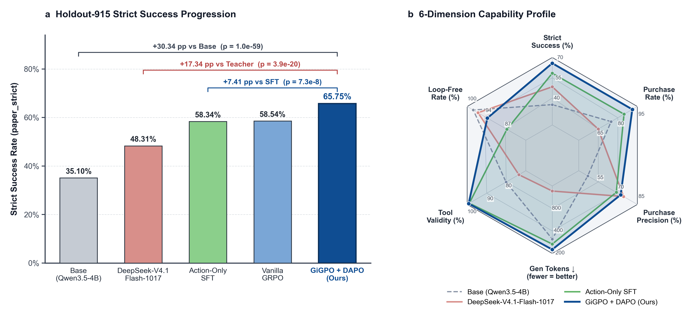
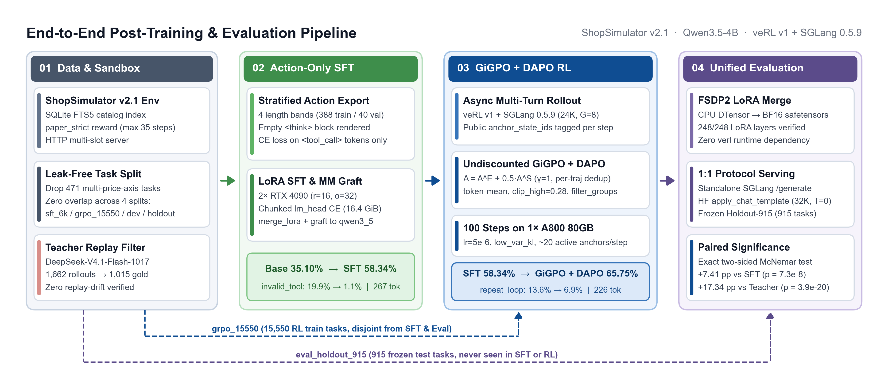

<a id="top"></a>

<div align="center">
  <h1>ShopMaster-4B</h1>
</div>

<div align="center">

[](https://howillmakeit.github.io/ShopMaster-4B/)&#160;
[](https://huggingface.co/HOWILLMAKEIT/ShopMaster-4B)&#160;
[](https://huggingface.co/HOWILLMAKEIT/ShopMaster-4B-SFT)&#160;
[](https://www.python.org/)&#160;
[](https://huggingface.co/Qwen/Qwen3.5-4B)&#160;
[](https://huggingface.co/datasets/wpei/ShopSimulator)&#160;
[](#-2-方法与流水线)&#160;
[](#-1-核心实验结果)&#160;
[](#评估口径paper_strict)

**用 300 元让 4B 小模型在中文电商多步购物任务上超越 DeepSeek-V4.1-Flash-1017**

**更少的 Token｜更少的 Step｜更高的成功率**

[🌐 项目主页](https://howillmakeit.github.io/ShopMaster-4B/) | [🤗 模型权重](https://huggingface.co/HOWILLMAKEIT/ShopMaster-4B) | [核心结果](#-1-核心实验结果) | [方法与流程](#-2-方法与流水线) | [端到端复现指南](#-3-端到端复现指南) | [项目结构](#-4-项目结构) | [来源与参考](#-5-来源与参考) | [资源消耗](#-6-资源消耗)

</div>

<p align="center">
  
</p>

> [!TIP]
> - 🌐 **交互式项目主页**：[**https://howillmakeit.github.io/ShopMaster-4B/**](https://howillmakeit.github.io/ShopMaster-4B/) — 含交互式 RL 训练曲线、Holdout-915 真实轨迹回放与工程优化拆解。
> - 🤗 **完整模型权重**：[**ShopMaster-4B (RL 最终版)**](https://huggingface.co/HOWILLMAKEIT/ShopMaster-4B) · [**ShopMaster-4B-SFT (Action-Only SFT)**](https://huggingface.co/HOWILLMAKEIT/ShopMaster-4B-SFT)

---

**ShopMaster-4B** 是面向 [ShopSimulator](https://huggingface.co/datasets/wpei/ShopSimulator) 中文多步购物环境的 4B 模型后训练与评测项目，完整打通 **防泄露数据划分 → Teacher 轨迹采集与过滤 → Action-Only SFT 蒸馏 → GiGPO + DAPO 强化学习 → 统一协议评测** 五阶段实验链路。

如上图所示，在完全冻结的 915 题留出测试集 `eval_holdout_915.jsonl` 上，**左图 a** 展示了模型的逐阶段跃升：`Qwen3.5-4B` 经 **Action-Only SFT** 从基座的 `35.10%` 升至 `58.34%`；`Vanilla GRPO` 基本原地踏步，而 100 步 **GiGPO + DAPO** 将严格成功率推至 **`65.75%`**，显著超过 `Action-Only SFT`、`Vanilla GRPO` 与 Zero-shot `DeepSeek-V4.1-Flash-1017`。**右图 b** 的六维能力雷达进一步说明了原因：`DeepSeek-V4.1-Flash-1017` 在下单精准度上保持领先，但在工具合规、购买率与生成开销上明显偏科；经 **Action-Only SFT** 与 **GiGPO + DAPO 强化学习** 后，4B 模型在效果、稳定性与效率六个维度上形成最均衡的包络，仅用教师约 `70%` 的交互步数与约 `1/6`（`16.5%`）的生成 Token，交出了更高的端到端准确率。

### ✨ Highlights

<table>
<tr>
<td align="center" width="25%">🏆<br/><b>65.75% 严格成功率</b><br/><sub>Holdout-915（599 / 911）</sub></td>
<td align="center" width="25%">📈<br/><b>+30.34 pp</b><br/><sub>vs Qwen/Qwen3.5-4B (Instruct)</sub></td>
<td align="center" width="25%">⚡<br/><b>+7.41 pp</b><br/><sub>vs Action-Only SFT</sub></td>
<td align="center" width="25%">🚀<br/><b>+17.34 pp</b><br/><sub>vs DeepSeek-V4.1-Flash-1017</sub></td>
</tr>
<tr>
<td align="center" width="25%">🎯<br/><b>步级锚点 GiGPO</b><br/><sub>公开状态无折扣信用</sub></td>
<td align="center" width="25%">⚖️<br/><b>DAPO 风格稳定更新</b><br/><sub>token-mean 与动态过滤</sub></td>
<td align="center" width="25%">🛡️<br/><b>防泄露基准划分</b><br/><sub>四套任务集严格零交集</sub></td>
<td align="center" width="25%">📏<br/><b>统一协议评测</b><br/><sub>严格口径与显著性检验</sub></td>
</tr>
</table>

<details>
<summary>📑 目录导航</summary>

- [1. 核心实验结果](#-1-核心实验结果)
  - [1.1 Holdout-915 最终测试集成绩单](#11-holdout-915-最终测试集成绩单)
  - [1.2 成对精确 McNemar 检验](#12-成对精确-mcnemar-检验)
  - [1.3 Insights](#13-insights)
- [2. 方法与流水线](#-2-方法与流水线)
  - [2.1 端到端实验流](#21-端到端实验流)
  - [2.2 关键设计拆解与参数对照](#22-关键设计拆解与参数对照)
- [3. 端到端复现指南](#-3-端到端复现指南)
- [4. 项目结构](#-4-项目结构)
- [5. 来源与参考](#-5-来源与参考)
- [6. 资源消耗](#-6-资源消耗)

</details>

---

## 📊 1. 核心实验结果

### 1.1 Holdout-915 最终测试集成绩单

所有模型均在隔离的 `ShopSimulator v2.1` 环境下评测，统一采用 `paper_strict` 口径、`max_steps=35` 与 915 题留出集 `eval_holdout_915.jsonl`。4 个 `Qwen3.5-4B` 系列模型在单卡 16GB GPU 上通过独立 SGLang `/generate` 与 `AutoTokenizer.apply_chat_template` 评测，统一设为 `max_model_len=32768`、`temperature=0.0`、`enable_thinking=false` 与 `turn_max_new_tokens=512`；`DeepSeek-V4.1-Flash-1017` 则通过 DeepSeek 官方 API 参数 `deepseek-flash` 调用，开启 `thinking=enabled`、`reasoning_effort=high` 与 `max_tokens=8192` 并行完成。

| 模型                                                     | 有效题 / 915 | `paper_strict` 严格成功率 |     全分母成功率 | 均分 (`Score`) |           购买率 | 下单精准度 (`Succ / Purch`) | `repeat_loop` |   `invalid_tool` | 题均步数 | 题均生成 Token |
| -------------------------------------------------------- | -----------: | --------------------------: | ---------------: | ---------------: | ---------------: | ----------------------------: | --------------: | -----------------: | -------: | -------------: |
| `base-nothink` (`Qwen3.5-4B`, no-think)              |    906 / 915 |                35.10% (318) |           34.75% |            0.382 |           74.83% |                        46.90% |       19 (2.1%) |        182 (19.9%) |      4.5 |            311 |
| `DeepSeek-V4.1-Flash-1017` (Zero-shot, high thinking)  |    915 / 915 |                48.31% (442) |           48.31% |            0.509 |           64.92% |              **74.41%** |       34 (3.7%) |        242 (26.4%) |      9.5 |          1,367 |
| `sft-b-ep2` (`Action-Only SFT`, ep2)                 |    905 / 915 |                58.34% (528) |           57.70% |            0.607 |           84.75% |                        68.84% |     124 (13.6%) |          10 (1.1%) |      8.2 |            267 |
| `v2-a800-001-step100` (Vanilla GRPO Step 100)          |    907 / 915 |                58.54% (531) |           58.03% |            0.609 |           86.66% |                        67.56% |     107 (11.7%) |          10 (1.1%) |      7.3 |            240 |
| `v2-a800-002-gigpo-step100` (**GiGPO + DAPO Step 100**) |    911 / 915 |      **65.75%** (599) | **65.46%** |  **0.675** | **91.11%** |                        72.17% |       63 (6.9%) | **7 (0.8%)** |      6.7 |  **226** |

**指标说明：**

- **有效题 / 915**：环境可核验价格并给出有效评分的题目数，少数题因购买了未标注价格轴的商品而记为无效。
- **严格成功率 / 全分母成功率 / 均分**：四项乘积得分达到 `1.0` 记为严格成功；严格成功率、均分与购买率以有效题为分母，全分母成功率以全部 915 题为分母。
- **下单精准度**：有效已购买样本中的严格成功率，满足 `严格成功率 = 购买率 × 下单精准度`。
- **`repeat_loop` / `invalid_tool`**：因陷入重复动作死循环或调用当前页面不可用工具而被终止的题数，括号内为占全部 915 题的比例。
- **加粗数值**：标记对应方向性指标列的全场最优值。

### 1.2 成对精确 McNemar 检验

以下基于同题有效交集 `n` 计算精确双侧 McNemar 检验，结果由 `shop_rl eval summarize` 产出：

| 对比组 (`A → B`)                                          | 有效配对数 `n` | 成功率变化 (`A → B`) |          `ΔSucc` | `ΔScore` | `B` 独赢 / `A` 独赢 |    Exact McNemar `p` |
| ------------------------------------------------------------ | ---------------: | :---------------------: | ------------------: | ----------: | :---------------------: | ---------------------: |
| `base-nothink → sft-b-ep2`                                |              898 |  `35.19% → 58.35%`  | **+23.16 pp** |     +0.2238 |     `+248 / -40`     |           `8.13e-38` |
| `sft-b-ep2 → v2-a800-001-step100` (Vanilla GRPO)          |              905 |  `58.34% → 58.67%`  |        `+0.33 pp` |     +0.0032 |      `+21 / -18`      |             `0.7493` |
| `sft-b-ep2 → v2-a800-002-gigpo-step100` (**GiGPO + DAPO**) |              904 |  `58.30% → 65.71%`  |  **+7.41 pp** |     +0.0680 |     `+111 / -44`     | **`7.28e-08`** |
| `v2-a800-001-step100 → v2-a800-002-gigpo-step100`         |              906 |  `58.50% → 65.67%`  |  **+7.17 pp** |     +0.0658 |     `+103 / -38`     | **`4.10e-08`** |
| `DeepSeek-V4.1-Flash-1017 → v2-a800-002-gigpo-step100`    |              911 |  `48.41% → 65.75%`  | **+17.34 pp** |     +0.1665 |     `+232 / -74`     | **`3.89e-20`** |

### 1.3 Insights

#### SFT 阶段：为什么选择 Action-Only SFT

在 474 题开发集 `eval_dev_474.jsonl` 上，统一在双卡 RTX 4090、64 并发、`verl val_only`、`T=0.0` 与 32K 上下文下对基座模型及各 SFT 范式第 2 轮检查点做控制变量对照，下表均按 474 全分母统计：

| 模型 / 范式                          | 起点权重               | 训练监督            | 推理思考 |      严格成功率 (/474) |       正常结束率 |         终局转化 | 题均生成 Token |    题均总 Token | `≥16K` 题数 | 题均步数 |        474 题耗时 |
| ------------------------------------ | ---------------------- | ------------------- | :------: | ---------------------: | ---------------: | ---------------: | -------------: | --------------: | -------------: | -------: | ----------------: |
| `Base` · 开思考                   | `Qwen3.5-4B`         | 无微调              |    开    |           29.75% (141) |           58.02% |           51.27% |          1,691 |           8,003 |             31 |     5.39 |          18.8 min |
| `Base` · 关思考                   | `Qwen3.5-4B`         | 无微调              |    关    |           31.86% (151) |           75.53% |           42.18% |            291 | **5,230** |    **5** |     4.11 | **7.7 min** |
| `Thought-Action SFT` · ep2        | `Qwen3.5-4B`         | 思考 + 动作         |    开    |           45.15% (214) |           69.20% |           65.24% |          2,080 |          13,786 |            157 |    13.89 |          55.1 min |
| `Thought-Action SFT` · ep2        | `Thought-Action ep2` | 思考 + 动作         |    关    |           42.41% (201) |           69.20% |           61.28% |            875 |          11,253 |             97 |    10.37 |          32.2 min |
| `Action-Only SFT` · ep2           | `Action-Only ep2`    | 仅工具动作          |    开    |           47.05% (223) |           75.74% |           62.12% |            705 |           8,189 |             53 |     7.50 |          18.5 min |
| **`Action-Only SFT` · ep2** | `Qwen3.5-4B`         | 仅工具动作          |    关    | **53.16%** (252) | **98.95%** |           53.73% |  **285** |           8,810 |             48 |     8.74 |          17.9 min |
| `Two-Stage SFT` · ep2             | `Action-Only ep2`    | 先动作后思考 + 动作 |    开    |           46.20% (219) |           67.72% | **68.22%** |          1,941 |          12,794 |            128 |    12.87 |          47.1 min |

- **发现一：4B 模型学习教师思维链会拉长输出并放大幻觉与工具违例，中途折损大于终局收益。** 引入思考监督后，模型单题输出显著膨胀。在多轮长观察的购物交互里，冗长思维链会增加长度与上下文截断风险，同时干扰模型对当前页面状态的跟踪，导致中后段频频出现过时商品 ID、缺失页签点击等非法调用。这类模型走到结账页时选品更准，但大量题目提前中止，整体成功率反而更低。
- **发现二：只监督教师动作同样可以训练购物 Agent 的各项核心能力，也是 4B 模型进入 RL 的理想起点。** 同为关闭思考，`Action-Only SFT` 把正常完结率推到接近满分，并明显提高了终局买对转化，效果优于先训思考再关闭思考的做法。高质量的「观察 → 动作」轨迹已经隐含教师的搜索、比价与选品决策，4B 模型无需冗长思维链即可内化这些偏好。把上下文空间留给环境观察后，剩余错误集中在终局选品与重复循环，适合交给后续 RL 优化。

#### RL 阶段：GiGPO + DAPO 的行为演化与反超机制

在冻结的 Holdout-915 测试集上，把各模型的分项评分与交互行为拆开看，可以看到 SFT 之后两种 RL 方案走向了截然不同的方向：

| 模型                                | 品类 `r_type` |  属性 `r_att` | 规格 `r_option` | 价格 `r_price` | 详情子页点击率 | 二次重搜率 | 均浏览商品数 |
| ----------------------------------- | --------------: | --------------: | ----------------: | ---------------: | -------------: | ---------: | -----------: |
| `base-nothink`                    |           0.994 |           0.800 |             0.555 |            0.925 |           8.7% |       9.7% |         1.06 |
| `DeepSeek-V4.1-Flash-1017`        | **0.997** | **0.916** |   **0.836** |            0.966 |          63.3% |      45.5% |         1.69 |
| `sft-b-ep2` (`Action-Only SFT`) | **0.997** |           0.863 |             0.751 |  **0.975** |          35.7% |      36.5% |         1.45 |
| `v2-a800-001` (Vanilla GRPO)      |           0.994 |           0.852 |             0.740 |            0.969 |          17.5% |      35.2% |         1.41 |
| `v2-a800-002` (**GiGPO + DAPO**) |           0.995 |           0.871 |             0.790 |            0.959 |           3.9% |      24.4% |         1.45 |

- **发现一：GRPO 的主要失分点在于找对商品却买错规格，步级信用直接补齐了这一短板。** 从分项分看，各模型的品类匹配 `r_type` 均接近满分，真正拉开差距的是规格匹配 `r_option`。在仅靠轨迹级稀疏终局奖励（终局发放四项乘积连续分 `r_strict ∈ [0, 1]`、无中间步过程奖励）的 `Vanilla GRPO` 下，终局得分会均摊到搜索、点商品与选规格每一步，模型难以定位具体出错的动作，最终只推高了下单率，精准度与 `r_option` 反而下滑。引入基于公开页面状态的步级锚点 GiGPO 后，同题下进入同一商品页的轨迹会在该节点横向对比，直接区分选对规格与选错规格的动作；配合 DAPO 风格的 `token-mean` 聚合、高上界裁剪与动态整组过滤，死循环占比减半，购买率、下单精准度与 `r_option` 同步提升。
- **发现二：RL 自发涌现出跳过详情子页、直接依靠搜索卡片与商品主页决策的更短路径。** 教师模型习惯高频点进描述、参数或评论子页核对，SFT 阶段也继承了这一倾向；进入 RL 后，详情子页点击率降到个位数，二次重搜也明显减少，同时均浏览商品数保持稳定。这一行为没有任何规则约束，由奖励驱动自然形成：在当前环境中，搜索卡片与商品主页已经包含大部分关键属性与规格，减少冗余子页跳转后，模型以更短步数和更少 Token 拿到了更高的 `r_att` 与 `r_option`。
- **发现三：4B 模型在端到端反超 `DeepSeek-V4.1-Flash-1017`，关键在于几乎消除了工具违例。** 走到结账环节时，`DeepSeek-V4.1-Flash-1017` 的下单精准度、`r_att` 与 `r_option` 仍为全场最高，说明其单步选品上限更高。系统提示与每轮观察 JSON 已明确列出当前页的 `actions` 列表与 `search_available` 约束，但 Zero-shot 下的 `DeepSeek-V4.1-Flash-1017` 仍频繁在子页未返回时点击不可用按钮或强行搜索。在单次违例即判零的评测口径下，四分之一以上的题目因此提前终止。4B 模型先经回放过滤的 SFT 压低非法调用，再借 GiGPO + DAPO 强化学习减少死循环并提高规格命中，依靠更高的全链路完成度实现端到端反超。

<p align="right"><a href="#top">🔝Back to top</a></p>

---

## ⚙️ 2. 方法与流水线

### 2.1 端到端实验流

<p align="center">
  
</p>

### 2.2 关键设计拆解与参数对照

#### 评估口径：`paper_strict`

严格遵循 ShopSimulator 论文公式 4 的四项乘积终局奖励，实现见 [paper_strict.py](env/shop_env/web_agent_site/engine/paper_strict.py)。未完成购买时得 `0`；执行 `click[buy now]` 且价格轴可核验时：

```math
r_{\mathrm{strict}}
=
r_{\mathrm{type}} \cdot r_{\mathrm{att}} \cdot r_{\mathrm{option}} \cdot r_{\mathrm{price}}
```

- `r_type`：品类与标题关键词匹配分，取值 `{0.0, 0.5, 1.0}`。
- `r_att`：目标属性命中比例，取值 `[0, 1]`。
- `r_option`：颜色、尺码、套餐等要求规格的命中比例，取值 `[0, 1]`。
- `r_price`：满足预算硬门控为 `1.0`，超预算或无法解析有效价格轴为 `0.0`。
- `paper_strict_success`：当且仅当 `r_strict >= 1.0 - 1e-6` 且 `reward_valid` 为真时记为 `1`，即严格满分成功。

#### 无折扣步级锚点 GiGPO

为解决仅靠轨迹级稀疏终局奖励（四项乘积连续分 `paper_strict_score ∈ [0, 1]`，无中间步反馈）时长死循环 `repeat_loop` 与多步试错缺乏细粒度步级信用的问题，[gigpo.py](src/shop_rl/rl/gigpo.py) 在仅使用环境公开 `observation_state` 的前提下计算双层优势：

```math
A(i, t)
=
A^{E}(\tau_i)
+
\omega \cdot A^{S}(i, t)
```

其中轨迹级优势 `A^E` 为标准组内归一化回报，开启 `norm_adv_by_std_in_grpo: true`；锚点步级优势 `A^S` 为同一题 `uid` 内到达相同公开状态锚点 `u` 的去重归一化均值差，取 `omega = 0.5` 与无折扣 `gamma = 1.0`。具体工程防偏置约束包括：

- **状态锚点编码**：仅基于环境公开 `observation_state` 中的页面状态字段生成三类规范化元组，分别是搜索结果页 `("search", normalized_query, page)`、商品详情页 `("item", asin, sorted_selected_options)` 与详情子页 `("subpage", asin, subpage, sorted_selected_options)`，再经 `blake2b` 哈希为 63-bit 整数 `anchor_state_id`；其中不包含动作签名，便于同一状态下的不同动作落入同一锚点组横向对比，并**跳过 `search_home`**，避免 Turn 0 首页被 `1 + omega` 倍放大权重。
- **轨迹内锚点去重**：同一条轨迹多次踩到同一锚点，例如 `repeat_loop` 反复点同一商品页，只入集合 `G_S(u)` 一次，防止死循环拉偏组内锚点均值与方差。
- **有效组门控**：仅在同锚点有效不同轨迹数 `|G_S(u)| >= 2` 且组内标准差 `sigma > 1e-6` 时叠加 `A^S(i, t)`。

#### 损失聚合与 Vanilla GRPO vs GiGPO + DAPO 参数对照

将 `loss_agg_mode` 从 `seq-mean-token-mean` 改为 `token-mean`：

```math
\mathcal{L}_{\text{token-mean}}
=
\frac{1}{\sum_{i=1}^{N} |y_i|}
\sum_{i=1}^{N}
\sum_{t \in y_i}
\ell_{i,t}
```

关闭思考后单步动作生成长度约 `33` token，旧的 `seq-mean-token-mean` 按 `1 / |y_i|` 对每条轨迹先平均再求和，会给 4 步简单题的每一步赋予约 13 步难题 `3.33x` 的梯度权重，同时稀释长 `repeat_loop` 败局的惩罚。改为全 batch 共享同一总生成 token 分母后，每一步决策获得等权重更新；配合 `enable_thinking: false` 与 KL 约束，不会诱导无意义变长。

| 配置项                       | `v2-a800-001`（[vanilla_grpo_a800_80g.yaml](configs/rl/vanilla_grpo_a800_80g.yaml)） | `v2-a800-002`（[gigpo_a800_80g.yaml](configs/rl/gigpo_a800_80g.yaml)） | 修改动机                                |
| ---------------------------- | ------------------------------------------------------------------------------------- | ----------------------------------------------------------------------- | --------------------------------------- |
| 优势估计 `adv_estimator`   | `grpo`                                                                              | **`gigpo`（`omega=0.5`, `gamma=1.0`）**                     | 引入无折扣公开锚点步级信用              |
| 损失聚合 `loss_agg_mode`   | `seq-mean-token-mean`                                                               | **`token-mean`**                                                | 消除按轨迹长度归一化的短轨迹偏置        |
| 上界裁剪 `clip_ratio_high` | `0.2`                                                                               | **`0.28`**                                                      | 放大高回报低概率新探索动作梯度          |
| 学习率 `optim.lr`          | `1.0e-6`                                                                            | **`5.0e-6`**                                                    | 解决 LoRA 100 步 KL 过小（0.00036）问题 |
| 采样与上下文                 | `16K`, `prompt=2048`, `top_p=1.0`                                               | **`24K`, `prompt=1024`, `top_p=0.95`**                      | 为多轮探索留足 `23,552` 生成预算      |
| 全同分过滤 `filter_groups` | 关闭                                                                                  | **开启（`metric=reward` + 整组驱逐补丁）**                      | 跳过全对/全错零方差组并同步重采样补批   |

<p align="right"><a href="#top">🔝Back to top</a></p>

---

## 🚀 3. 端到端复现指南

以下按**数据处理 → 环境服务 → 教师采集与 SFT → RL 训练 → 合并评测**顺序给出完整命令。未单独标注时，默认在仓库根目录 `ShopMaster-4B/` 下执行。

### Step 0：安装基础环境与准备底座模型

- **环境要求**：Linux + NVIDIA GPU，Python `3.10+`，推荐使用 [`uv`](https://docs.astral.sh/uv/) 管理虚拟环境。
- **安装项目 CLI 与环境依赖**：

```bash
uv venv --python 3.10 .venv
uv pip install --python .venv/bin/python -r env/shop_env/requirements.txt pyyaml openai requests httpx pyarrow pydantic
uv pip install --python .venv/bin/python --no-deps -e .
```

- **下载底座模型**至 `models/Qwen3.5-4B`：

```bash
huggingface-cli download Qwen/Qwen3.5-4B --local-dir models/Qwen3.5-4B
```

- **验证命令**：`.venv/bin/shop_rl --help` 应当输出 `data`、`train`、`eval`、`rl` 四个命令组。

---

### Step 1：解压商品全集、构建搜索索引并核验任务划分

- **输入**：压缩商品全集 [fine_items_eval_train_all.json.gz](env/shop_env/data/fine_items_eval_train_all.json.gz) 与仓库已入库的原始任务列表 [data/fine_items_train_standard.jsonl](data/fine_items_train_standard.jsonl)、[data/fine_items_eval_standard.jsonl](data/fine_items_eval_standard.jsonl)。
- **处理与命令**：解压生成 `items_eval_train.json` 并构建 SQLite FTS5 搜索索引 `products.sqlite3`，两者体量较大均不入 Git：

```bash
gzip -cd env/shop_env/data/fine_items_eval_train_all.json.gz > env/shop_env/data/items_eval_train.json
.venv/bin/python env/shop_env/scripts/build_index.py
```

- 仓库已在 `data/tasks/` 提交确定性任务划分；如需从原始标准文件重算，执行：

```bash
.venv/bin/python -I env/single_eval/collect_teacher.py prepare
```

- **任务划分规模与零泄露约束**，详细清洗规则见 [data/README.md](data/README.md)：

| 清单文件                                 | 用途                     |           题目数 | `task_id` 边界与清洗规则                                        |
| ---------------------------------------- | ------------------------ | ---------------: | ----------------------------------------------------------------- |
| `data/tasks/eval_dev_474.jsonl`        | 开发选型                 |    **474** | `0–1458` 抽 500 题，静态剔除 26 道多/未定价格轴题              |
| `data/tasks/eval_holdout_915.jsonl`    | **冻结最终留出集** |    **915** | 其余 959 题剔除 44 道价格不可核验题                               |
| `data/tasks/sft_candidate_tasks.jsonl` | SFT 采集候选池           |  **6,000** | `>= 1459` 剔除与评测重合及重复需求后按大类分层抽样，`seed=42` |
| `data/tasks/grpo_tasks.jsonl`          | RL 训练集                | **15,550** | `>= 1459` 余下候选再剔除 401 道价格不可核验题                   |

---

### Step 2：启动 ShopSimulator v2.1 HTTP 环境服务

- **输入**：`products.sqlite3`、`items_eval_train.json` 与 [environment.json](env/shop_env/configs/environment.json)，其中已锁定 `reward.mode: paper_strict` 与 `max_steps: 35`。
- **处理与命令**：按并发需要设置槽位数 `SHOPSIM_ENV_SLOTS`，并在后台启动环境服务前清掉本地代理环境变量：

```bash
unset http_proxy https_proxy HTTP_PROXY HTTPS_PROXY all_proxy ALL_PROXY
PATH="$(pwd)/.venv/bin:$PATH" \
SHOPSIM_PORT=5705 \
SHOPSIM_ENV_SLOTS=16 \
nohup bash env/shop_env/start.sh > outputs/pack_api_5705.log 2>&1 < /dev/null &
```

- **验证**：`curl -sf -X POST http://127.0.0.1:5705/api/shop_agent -H "Content-Type: application/json" -d '{"action":"release_all"}'` 返回 `{"result":{"message":"All environments have been initialized"}}`。

---

### Step 3：准备 Teacher 轨迹并导出 Action-Only SFT 训练集

1. **直接解压复用仓库内置的 1,015 条回放 0 误差教师轨迹**：推荐方式，无需消耗 DeepSeek API 额度。解压后文件路径与索引 [data/sft/success_tasks.jsonl](data/sft/success_tasks.jsonl) 严格一致：

```bash
mkdir -p outputs/teacher
tar -xzf data/sft/teacher_success_1015.tar.gz -C outputs/teacher/
```

<details>
<summary>可选：从头调用 DeepSeek API 重新采集并回放校验</summary>

请先将 `env/single_eval/configs/standard/teacher.yaml` 中的 `env_config.base_url` 指向 Step 2 启动的环境端口，例如 `http://127.0.0.1:5705`；回放校验只保留买对且零重放偏差的轨迹并写入 `data/sft/success_tasks.jsonl`：

```bash
export TEACHER_API_KEY="<YOUR_DEEPSEEK_API_KEY>"
.venv/bin/python -I env/single_eval/collect_teacher.py collect \
  --yaml env/single_eval/configs/standard/teacher.yaml --workers 8 --target 1000
.venv/bin/python -I env/single_eval/collect_teacher.py replay \
  --yaml env/single_eval/configs/standard/teacher.yaml
```

</details>

2. **统计长度分布并导出 Action-Only SFT 训练集**：

```bash
.venv/bin/shop_rl data bands
.venv/bin/shop_rl data export --strategy B --out-dir data/sft/v1
```

- **预期输出**：按带思考长度分 4 档以 `seed=42` 分层抽样，生成 `data/sft/v1/sft_B.pkl` 与 `manifest_B.json`，含 388 条训练与 40 条验证样本。其中 `--strategy B` 对应 **Action-Only SFT**，会将每轮 assistant 思考段置空并只在 `<tool_call>` 动作段计入 loss。

---

### Step 4：LoRA SFT 训练、合并与多模态壳嫁接

- **说明**：[sft.py](src/shop_rl/train/sft.py) 使用 `AutoModelForCausalLM` 文本视图配合分块交叉熵训练 LoRA。训练完成后需经 [merge_lora.py](src/shop_rl/train/merge_lora.py) 与 [graft.py](src/shop_rl/train/graft.py) 写回 `Qwen3.5-4B` 多模态分片，以便 SGLang 以 `qwen3_5` 模型类型直接加载。

```bash
# 1. 双卡 LoRA SFT 训练（需 PyTorch + transformers + peft）
PYTORCH_CUDA_ALLOC_CONF=expandable_segments:True \
  torchrun --nproc_per_node=2 -m shop_rl.train.sft \
  --data data/sft/v1/sft_B.pkl \
  --model-dir models/Qwen3.5-4B \
  --out outputs/v1/sft-b

# 2. 合并文本 LoRA 并嫁接回多模态 checkpoint 壳（生成 ep1/2/3）
python -m shop_rl.train.merge_lora \
  --src models/Qwen3.5-4B \
  --adapter-tmpl "outputs/v1/sft-b/adapter-ep{}" \
  --out-tmpl "models/qwen3.5-4b-sftb-ep{}"

python -m shop_rl.train.graft \
  --src models/Qwen3.5-4B \
  --text-tmpl "models/qwen3.5-4b-sftb-ep{}" \
  --out-tmpl "models/qwen3.5-4b-sftb-mm-ep{}"
```

- **预期输出**：产出开发集最优起点权重 `models/qwen3.5-4b-sftb-mm-ep2`，其张量计数与 `Qwen3.5-4B` 原分片严格一致，视觉塔权重原样保留。

---

### Step 5：生成 RL 与统一评测 Parquet 任务集

- **输入**：`data/tasks/{grpo_tasks,eval_dev_474,eval_holdout_915,sft_candidate_tasks}.jsonl` 与 `env/shop_env/data/items_eval_train.json`。
- **处理与命令**：强制校验训练、开发、留出与 SFT 四套集合两两零交集、`task_id > 1458` 边界以及零价格不可核验题目，生成仅包含公开 `SHOP_SYSTEM_PROMPT` 与 `extra_info.task_id` 的 `verl` 标准 Parquet：

```bash
.venv/bin/shop_rl rl prepare-tasks --output-dir data/rl
```

- **预期输出**：写出 `data/rl/{train,val_dev474,val_dev100,val_smoke20,eval_holdout915,smoke_train8,smoke_val2}.parquet` 及校验清单 `data/rl/manifest.json`。

---

### Step 6：RL 训练——Vanilla GRPO 与 GiGPO + DAPO

> 前置条件：需要基于 `verl` `v1` 架构的 GPU 训练环境，并安装 `sglang==0.5.9`、`torch==2.9.1+cu126`、`transformers==5.9.0` 与 `flash-linear-attention==0.6.0`，推荐使用 80GB 单卡。

1. **为 `verl` 应用轻量透传补丁并验证注册通路**：全部 GiGPO 算法实现均保留在本仓库 [gigpo.py](src/shop_rl/rl/gigpo.py) 与 [agent_loop.py](src/shop_rl/rl/agent_loop.py) 中，[verl-v1-gigpo-and-sync-refill.patch](patches/verl-v1-gigpo-and-sync-refill.patch) 仅改动 4 个文件，用于把每步生成的 `anchor_state_ids` 透传至优势计算阶段、按需触发 `import shop_rl.rl.gigpo` 注册并修复 `filter_groups` 整组驱逐：

```bash
# 在 verl 源码目录打入补丁并以可编辑模式安装到训练环境
cd /path/to/verl
git apply --check /path/to/ShopMaster-4B/patches/verl-v1-gigpo-and-sync-refill.patch
git apply /path/to/ShopMaster-4B/patches/verl-v1-gigpo-and-sync-refill.patch
pip install --no-deps -e .

# 回到 ShopMaster-4B 目录，验证 gigpo 已能通过 PYTHONPATH 自动注册进 verl
cd /path/to/ShopMaster-4B
PYTHONPATH="$(pwd)/src" python -c "import shop_rl.rl.gigpo; from verl.trainer.ppo import core_algos; print('gigpo' in core_algos.ADV_ESTIMATOR_REGISTRY)"
```

2. **启动正式 GiGPO + DAPO 24K 训练**：训练日志中持续打印 `[GiGPO] bsz=... active_anchors=...` 且 `active_anchors > 0`，即表明步级状态锚点已完整生效：

```bash
export PYTHONPATH="$(pwd)/src:${PYTHONPATH:-}"
export SHOP_ENV_BASE_URL="http://127.0.0.1:5705"
export SHOP_RL_ENV_SLOTS=32
export SHOP_RL_GIGPO_OMEGA=0.5
export SHOP_RL_SFT_MODEL="$(pwd)/models/qwen3.5-4b-sftb-mm-ep2"
export SHOP_RL_AGENT_LOOPS="$(pwd)/configs/rl/agent_loops.yaml"
export SHOP_RL_TRAIN_PARQUET="$(pwd)/data/rl/train.parquet"
export SHOP_RL_DEV_PARQUET="$(pwd)/data/rl/val_dev100.parquet"
export SHOP_RL_LOG_DIR="$(pwd)/outputs/v2/rl/v2-a800-002-gigpo/segments/seg01"
export SHOP_RL_CKPT_DIR="$(pwd)/outputs/v2/rl/v2-a800-002-gigpo/checkpoints"
export VERL_FILE_LOGGER_PATH="${SHOP_RL_LOG_DIR}/verl_metrics.jsonl"

# 可选：并启动实时监控写入 TensorBoard
shop_rl rl monitor \
  --log-dir "${SHOP_RL_LOG_DIR}" \
  --tb-dir "$(pwd)/outputs/v2/rl/v2-a800-002-gigpo/tensorboard" \
  --group-size 8 --watch --interval 15 &

python -m verl.trainer.main_ppo \
  --config-path "$(pwd)/configs/rl" \
  --config-name gigpo_a800_80g \
  trainer.total_training_steps=100 \
  trainer.test_freq=20 \
  trainer.save_freq=5
```

- 对照实验只需将 `--config-name` 改为 `vanilla_grpo_a800_80g`。100 步产出 LoRA checkpoint `checkpoints/global_step_100/actor/model_world_size_1_rank_0.pt`，体量约 125 MB、包含 496 个张量。

---

### Step 7：导出并合并 FSDP2 RL LoRA 权重

若在未安装 `verl` 的 16GB 单卡上评测，需先把 FSDP2 `DTensor` LoRA 转为纯 CPU `.pt`，再通过 [merge_verl_lora.py](src/shop_rl/train/merge_verl_lora.py) 合并进 SFT 基座分片：

```bash
# 1. 在训练环境导出纯 CPU LoRA 字典（仅需执行一次，无需 GPU）
python - << 'EOF'
import torch
sd = torch.load("outputs/v2/rl/v2-a800-002-gigpo/checkpoints/global_step_100/actor/model_world_size_1_rank_0.pt", map_location="cpu", weights_only=False)
torch.save({k: (v.to_local() if hasattr(v, "to_local") else v).detach().cpu().contiguous() for k, v in sd.items()}, "models/gigpo100-lora-cpu.pt")
EOF

# 2. 合并回多模态 BF16 Safetensors（校验 248/248 层匹配且 max_abs_diff > 0）
python -m shop_rl.train.merge_verl_lora \
  --base-model models/qwen3.5-4b-sftb-mm-ep2 \
  --lora-pt models/gigpo100-lora-cpu.pt \
  --lora-meta outputs/v2/rl/v2-a800-002-gigpo/checkpoints/global_step_100/actor/lora_train_meta.json \
  --output-dir models/qwen3.5-4b-gigpo100-mm
```

---

### Step 8：Holdout-915 评测与成对显著性汇总

本项目提供两种等价评测入口，均输出格式完全兼容的 `rollouts-*.jsonl` 与 `eval_summary.json`：

- **方式 A**：在 ≥24GB GPU 与 `verl` 环境下，直接通过 [eval/run.py](src/shop_rl/eval/run.py) 拉起：

```bash
shop_rl eval run \
  --model-path models/qwen3.5-4b-sftb-mm-ep2 \
  --checkpoint outputs/v2/rl/v2-a800-002-gigpo/checkpoints/global_step_100 \
  --split holdout915 \
  --max-model-len 32768 \
  --output-dir outputs/eval/holdout915/v2-a800-002-gigpo-step100
```

- **方式 B**：在 16GB 单卡上通过独立 SGLang `/generate` 与 [serve_eval.py](src/shop_rl/eval/serve_eval.py) 评测，避免 FSDP2 与 SGLang 双占显存，直接加载已 merge 模型：

```bash
# 1. 启动 SGLang（注意 --disable-radix-cache 规避 SGLang 0.5.9 Mamba 缓存泄漏）
unset http_proxy https_proxy HTTP_PROXY HTTPS_PROXY all_proxy ALL_PROXY
python -m sglang.launch_server \
  --model-path models/qwen3.5-4b-gigpo100-mm \
  --host 127.0.0.1 --port 8010 \
  --context-length 32768 --mem-fraction-static 0.80 --max-running-requests 8 \
  --disable-radix-cache --attention-backend triton --sampling-backend pytorch &

# 2. 执行 915 题异步断点评测（直接使用原生 /generate + HF chat_template）
HF_HUB_OFFLINE=1 TRANSFORMERS_OFFLINE=1 \
python -m shop_rl.eval.serve_eval \
  --base-url http://127.0.0.1:8010 \
  --model-path models/qwen3.5-4b-gigpo100-mm \
  --env-url http://127.0.0.1:5705 \
  --tasks data/tasks/eval_holdout_915.jsonl \
  --output-dir outputs/eval/holdout915/v2-a800-002-gigpo-step100 \
  --label v2-a800-002-gigpo-step100 \
  --concurrency 8 --max-model-len 32768 --temperature 0.0 --enable-thinking false --resume
```

- **汇总全量对比与 McNemar 显著性检验**：

```bash
shop_rl eval summarize \
  --run base-nothink=outputs/eval/holdout915/base-nothink \
  --run sft-b-ep2=outputs/eval/holdout915/sft-b-ep2 \
  --run v2-a800-001-step100=outputs/eval/holdout915/v2-a800-001-step100 \
  --run v2-a800-002-gigpo-step100=outputs/eval/holdout915/v2-a800-002-gigpo-step100 \
  --run teacher-deepseek=outputs/eval/holdout915/teacher-deepseek \
  --expected-tasks data/tasks/eval_holdout_915.jsonl \
  --out-json outputs/eval/holdout915/holdout915-report.json
```

---

### Step 9：运行单元测试

```bash
# 1. ShopSimulator v2.1 环境与 paper_strict 计分单测（31 passed, 19 subtests）
PYTHONPATH=env/shop_env .venv/bin/python -m pytest -q env/shop_env/tests

# 2. GiGPO 锚点编码、去重、无折扣优势与评测汇总单测
PYTHONPATH=src .venv/bin/python -m pytest -q tests/test_gigpo.py tests/test_eval_pipeline.py tests/test_rl_monitor.py
```

<p align="right"><a href="#top">🔝Back to top</a></p>

---

## 📁 4. 项目结构

```text
ShopMaster-4B/
├── index.html                              # GitHub Pages 交互式项目主页
├── pyproject.toml                          # shop_rl CLI 包定义，零外部包耦合
├── assets/
│   ├── holdout915_overview.{png,pdf}       # Holdout-915 主成绩与六维能力雷达总览图
│   └── pipeline_overview.{png,pdf}         # 四阶段端到端实验流与防泄露路由图
├── configs/
│   └── rl/
│       ├── agent_loops.yaml                # 注册 shopping_agent
│       ├── vanilla_grpo_a800_80g.yaml      # 基线 Vanilla GRPO + KL 配置，16K
│       ├── gigpo_a800_80g.yaml             # 正式 GiGPO + DAPO 配置，24K
│       └── eval_4090_24g.yaml              # 双卡 4090 32K verl 评测配置
├── data/
│   ├── README.md                           # 数据来源、SHA256 与防泄露清洗规则
│   ├── fine_items_{train,eval}_standard.jsonl
│   ├── tasks/                              # sft_6k / grpo_15550 / dev474 / holdout915 清单
│   ├── sft/
│   │   ├── success_tasks.jsonl             # 1,015 条回放 0 误差教师轨迹索引
│   │   └── teacher_success_1015.tar.gz     # 1,015 条教师轨迹压缩包，17.0 MiB，解压即可导出 SFT
│   └── rl/                                 # [gitignored] prepare-tasks 产出的 Parquet 与 manifest.json
├── env/
│   ├── get_score.py                        # 历史单轮计分兼容工具
│   ├── shop_env/                           # ShopSimulator v2.1 服务端，含 paper_strict.py 与单测
│   └── single_eval/                        # Teacher 采集端：agent.py, collect_teacher.py, tool_adapter.py
├── patches/
│   └── verl-v1-gigpo-and-sync-refill.patch # verl v1 GiGPO 注册与整组驱逐补齐补丁
├── src/shop_rl/
│   ├── cli.py                              # 统一命令路由: shop_rl <data|train|eval|rl> <cmd>
│   ├── data/                               # align_task_ids.py, length_bands.py, export_sft.py
│   ├── train/                              # sft.py, merge_lora.py, graft.py, merge_verl_lora.py
│   ├── rl/                                 # agent_loop.py, gigpo.py, prepare_tasks.py, monitor.py
│   └── eval/                               # run.py, serve_eval.py, summarize.py
├── tests/
│   ├── test_gigpo.py                       # GiGPO 与锚点编码单测
│   ├── test_eval_pipeline.py               # 评测切分、Wilson CI 与 McNemar 检验单测
│   └── test_rl_monitor.py                  # 实时监控聚合器单测
├── models/                                 # [gitignored] 底座与 merge 权重
└── outputs/                                # [gitignored] 实验日志、TensorBoard、rollouts 与汇总索引 README
```

<p align="right"><a href="#top">🔝Back to top</a></p>

---

## 📚 5. 来源与参考

- [ShopSimulator 论文 arXiv:2601.18225 与数据集 `wpei/ShopSimulator`](https://huggingface.co/datasets/wpei/ShopSimulator) — ACL 2026，参考其中文多步购物基准环境、商品与任务数据集及 `paper_strict` 四项乘积评估口径，对应仓库 commit `ab34b289`。
- [Qwen/Qwen3.5-4B 模型卡片](https://huggingface.co/Qwen/Qwen3.5-4B) — 阿里云 Qwen 团队，作为全部 SFT 与 RL 实验的基座模型，参考其官方聊天模板、无思考开关与工具调用格式。
- [DeepSeek API 文档](https://api-docs.deepseek.com/) — DeepSeek 团队，使用 `DeepSeek-V4.1-Flash-1017` 与 API 参数 `deepseek-flash` 作为教师模型完成轨迹采集与 Zero-shot 对照评测。
- [veRL: Volcano Engine Reinforcement Learning](https://github.com/volcengine/verl) — 参考其 FSDP2 与 Async SGLang `AgentLoop` 多轮交互式强化学习训练框架。
- [SGLang](https://github.com/sgl-project/sglang) — 参考其高性能推理后端与 `qwen3_coder` 工具调用解析器，实测版本 `0.5.9`。
- [GiGPO: Group-in-Group Policy Optimization](https://arxiv.org/abs/2505.10978) — 参考其面向多轮 LLM Agent 的轨迹级与步级锚点复合优势设计。
- [DAPO: An Open-Source LLM Reinforcement Learning System](https://arxiv.org/abs/2503.14476) — 参考其 `token-mean` 损失聚合、不对称上界裁剪 `clip_ratio_high` 与动态整组过滤思路。

<p align="right"><a href="#top">🔝Back to top</a></p>

---

## ⏱️ 6. 资源消耗

以下汇总自项目各阶段实际日志，涵盖训练、评测及常规调优测试开销：

| 资源类型                                               | 主要用途                                                                 |                        总消耗 |
| ------------------------------------------------------ | ------------------------------------------------------------------------ | ----------------------------: |
| **DeepSeek API** · `DeepSeek-V4.1-Flash-1017` | 教师数据采集 1,662 题与 Holdout-915 评测，输入 `150.5M`、输出 `3.1M` | **约 `153.6M` Token** |
| **RTX 4090 24GB** · 双卡折算                    | SFT 训练、`val_dev474` 统一重评与前期联调测试                          |    **约 `21 GPU·h`** |
| **A800 80GB** · 单卡                            | RL 调优测试与 Vanilla GRPO、GiGPO + DAPO 两轮 100 步正式训练            |    **约 `30 GPU·h`** |
| **RTX 4080 SUPER 16GB** · 单卡                  | 4 个 4B 模型的 Holdout-915 最终评测                                      |     **约 `5 GPU·h`** |

注：多轮对话历史前缀高度重合，DeepSeek API 实测约 `86%` 输入命中前缀缓存，实际账单成本远低于按全量无缓存估算的费用。

---

<sub>资料核对日期：2026-11-24</sub>

<p align="right"><a href="#top">🔝Back to top</a></p>
